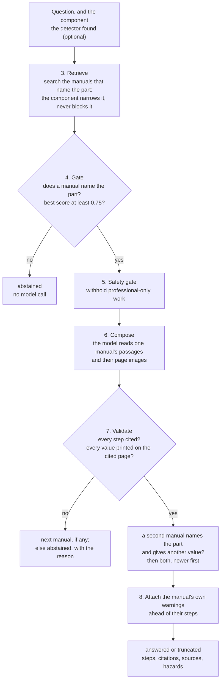

# How `/ask` answers a question

`POST /api/ask` takes a question, and optionally the component the detector found in the user's photograph. It returns steps taken from the Shimano manuals, each with the manual and page it came from, or it says that the manuals do not hold the answer.

This page walks through what happens to a question, with real responses from the stack on 2026-11-16. The decisions behind it are in [ADR 0003](adr/0003-local-llm.md) (the model) and [ADR 0004](adr/0004-ask-pipeline.md) (everything else). Every number here can be reproduced with the commands in [bench/README.md](../bench/README.md).

## Which model sees what

Three models are involved, and they do different jobs. Only one of them is a language model.

| Model | What it reads | What it gives | Trained by us? |
|---|---|---|---|
| The **detector** (YOLO, `/api/detect`, Sprint 5) | The user's photograph | A component class, such as `rear_derailleur`, with a box and a score | Yes, fine-tuned on our photographs |
| The **embedder** (`bge-small-en-v1.5`) | The question, and every manual passage at indexing time | A vector, used to search and to score how well a passage matches | No |
| The **language model** (`qwen3.5:4b`) | The question, the retrieved manual passages, and the rendered manual pages they come from | The answer as steps, each naming the passages it used | No |

The language model never sees the user's photograph. The detector turns the photograph into a class name, and `/ask` receives that name as `confirmed_component`. The language model is a vision-language model because it reads the *manual's* pages as images: a torque table keeps its rows and a figure keeps its labels, which the extracted text loses. It also describes the manuals' figures once, at indexing time, so that they can be searched.

Nothing is fine-tuned to make the model follow the manuals. It follows them because it is shown nothing else, and because code checks its answer afterwards.

## The path of one question



The numbers are the stages of the request path in the plan (§5.1). Stages 1 and 2, capture and detect, happen before `/ask`.

| Stage | What it does | Uses a model? | Code |
|---|---|---|---|
| 3. Retrieve | Hybrid search (meaning and keywords) over the manuals that name the part in the question. The five best passages are kept. | The embedder | `app/rag/retrieval.py` |
| 4. Gate | Abstains unless a manual names the part and the best passage scores at least 0.75. | No | `app/rag/gate.py` |
| 5. Safety gate | Withholds passages marked professional-only, so the model cannot describe that work. | No | `app/rag/hazards.py` |
| 6. Compose | The language model answers from one manual's passages and their page images. | The language model | `app/rag/generation.py` |
| 7. Validate | Refuses the answer unless every step cites a passage and every value is printed on the cited page. | No | `app/rag/grounding.py` |
| 8. Warnings | Attaches the manual's own warning sentences ahead of the steps they concern. | No | `app/rag/hazards.py` |

Stages 4, 5, 7 and 8 are plain code. That is what the plan means by "Rules 1 to 4 are deterministic checks that run outside the language model": the safety of an answer does not depend on the model behaving well.

## Nine questions, and what happened to each

All of these are real responses. The first seven came through `curl` against the running backend; the last two are from the end-to-end test.

### 1. A value: answered, with its page

> **What is the tightening torque for the caliper mounting screw on a BR-R9270 disc brake caliper?**

```json
{
  "status": "answered",
  "steps": [{"number": 1, "text": "6 - 8 N·m",
             "citation": {"document_id": "DM-TORQUE-04", "page": 8, "chunk_id": "DM-TORQUE-04:p8:c1"}}],
  "sources": [{"document_id": "DM-TORQUE-04", "document_title": "Torque Chart (all series)",
               "is_manufacturer_manual": true}],
  "confidence": 0.84
}
```

- **Retrieve.** The question names `BR-R9270`, so only the manuals that name that part were searched.
- **Gate.** The best passage scored 0.84, above 0.75: open.
- **Compose and validate.** The model answered `6 - 8 N·m` and cited the passage. The check found `6-8` printed on page 8 of the torque chart, so the answer went out.

Once the model is loaded, a response like this takes 1 to 2 seconds on an RTX 5070, nearly all of it the model call.

### 2. A part that does not exist: refused in 55 milliseconds

> **What is the tightening torque for the caliper mounting screw on a BR-Z9999 disc brake caliper?**

```json
{"status": "abstained", "confidence": 0.0, "stop_reason": "no indexed manual names BR-Z9999"}
```

There is no BR-Z9999. A plain search returns the torque tables of the real calipers, which match every other word of the question, and a model shown those tables may pick a neighbour's value. Here the question never reaches the model: no manual names the part, so the gate closes. No model call was made, which is why it took 55 ms.

### 3. Outside the manuals: refused at the threshold

> **How long is the warranty on Shimano components?**

```json
{"status": "abstained", "confidence": 0.71, "stop_reason": "no passage reaches the threshold (0.71 < 0.75)"}
```

This is the plan's own example (§4.2, step 9). The best passage scored 0.71, under the threshold of 0.75, so the answer is an abstention and no model was called.

To prove that last part, Ollama was stopped and the question asked again: the response was the same abstention, with HTTP 200. An answerable question asked at the same moment got HTTP 503, "The language model does not answer. Start it with: docker compose --profile local up".

### 4. A vague question, and the photograph says what it is about

> **How tight should this be?** with `confirmed_component: "pedal"`

```json
{"status": "answered", "steps": [{"number": 1, "text": "35 - 55 N·m",
  "citation": {"document_id": "DM-PD0001-05", "page": 8, "figure": "DM-PD0001-05/p008-1.png"}}],
 "confidence": 0.77}
```

On its own this question matches nothing well: its best passage scores 0.62 and it would be refused. With the component, the search is limited to the pedal manuals and the word "pedal" is added to the question. The best passage then scores 0.77, and the answer is the pedal's mounting torque from the pedal manual. This is what the detector is for (US-02, US-13).

### 5. The photograph shows one part, the question is about another

> **How do I bleed the brakes?** with `confirmed_component: "cassette"`

The answer came from the brake manual DM-LADBR01-04, page 49, as four steps, although the photograph showed a cassette.

The detected component is a hint, not a wall. Before limiting the search to the cassette manuals, `/ask` compares the best passage those manuals offer (0.65) with the best passage of all the manuals (0.78). The gap is far above the margin of 0.02, so the question is read as being about something else, and every manual is searched. If the component's manuals had been close but then gave no answer, `/ask` would have searched every manual once more.

Measured on 32 labelled questions: with a deliberately wrong component used as a hard filter, the answer page survives for 6. With the hint, for 26, before that second search. With no component at all, for 29.

### 6. Two manuals disagree: both, newer first

> **Which hexagon wrench removes the bleed screw on an ST-R7020 lever?**

```json
{
  "status": "answered",
  "steps": [
    {"number": 1, "text": "Hydraulic Disc Brake and Dual Control Lever (Dura-Ace Ultegra 105) (DM-RADBR01-11, printed 2025-04): 2.5 mm hexagon wrench",
     "citation": {"document_id": "DM-RADBR01-11", "page": 31}},
    {"number": 2, "text": "Torque Chart (all series) (DM-TORQUE-04, printed 2023-12): 2 mm hexagon wrench",
     "citation": {"document_id": "DM-TORQUE-04", "page": 13}}
  ]
}
```

Shimano's own documents disagree here. No small model handled this when asked to in the prompt: each gave one value and said nothing of the other (ADR 0003). So the code does it. The model is asked about one manual at a time and never sees both values together. When the answer is a single value and a second manual names the same part, that manual is asked too. The two values differed, so both are returned, the newer manual first, each with its manual and print date.

### 7. A warning, in the manual's words, ahead of its step

> **How do I remove the lock ring of a CS-M8200 cassette?**

The response has one step, from DM-MACS010-02 page 11, and two hazards with `before_step: 1`: the manual's sentence telling the reader to wear gloves and eye protection and apply force gradually, and its sentence that a sudden release of resistance on the lock ring may cause serious injury.

The model did not write these and was not asked for them. After the answer passed its check, the page the step cites was matched against the hazard list (`app/rag/hazards.json`), and the matching sentences were attached as the manual prints them. A model cannot leave a warning out, because it is not the one that adds it.

### 8. The gate lets it through, and the model refuses

> **What is the tightening torque for the mounting bolt of a SRAM GX Eagle rear derailleur?**

The corpus is Shimano only. The best passage, a Shimano rear derailleur mounting page, scored 0.76, just above the threshold, so the gate opened. The model was shown the passages of three manuals in turn and found no answer in any of them. The response is an abstention.

This is the one unanswerable question of the 28 that got past the gate, and it shows why the model's own behaviour still matters. `qwen3.5:4b` was chosen because it abstains here; some other models invent an answer (see the comparison below).

### 9. A wrong answer that got through

> **What is the tightening torque for the fixing screw when installing an MTB hydraulic disc brake lever?**

The manual says 4 - 6 N·m, on page 11 of DM-MADBR01-08. The response was **0.2 - 0.3 N·m**, citing page 94 of the torque chart.

What went wrong, stage by stage:

- **Retrieve.** The question names no part code, so every manual was searched. The right page was not among the five passages.
- **Gate.** The passages are about brake levers and scored 0.81: open.
- **Compose.** Shown a torque chart page for a different brake lever, the model took a value from it.
- **Validate.** The value *is* printed on the page the model cited, so the check passed.

This is the failure the checks cannot catch: a real value, really printed on the cited page, for the wrong bolt. It is the only wrong answer of the 69 questions, and it has the two features that make it likely: no part code in the question, and a search that missed the page. The user still sees the cited page, which is a brake lever of another series. Narrowing this is an open item in ADR 0004.

## The numbers

69 labelled questions: 41 that the manuals answer, 28 that they do not (out of scope, other brands, parts that do not exist, facts a manual does not give). With `qwen3.5:4b`, two page images, threshold 0.75, on 2026-11-16:

| | All 69 | The 22 held out from calibration |
|---|---|---|
| Answerable questions answered correctly | 36 of 41 | 11 of 13 |
| Answered wrongly | 1 | 1 |
| Answerable but abstained on | 4 | 1 |
| Unanswerable questions refused | 28 of 28 | 9 of 9 |
| Of those, refused before any model call | 27 | 8 |
| Time for an answer, median | 1.4 s | |

How to read it:

- **No unanswerable question was answered.** 27 of 28 never reached the model.
- **One wrong answer in 41**, example 9.
- **Four answers lost.** One at the gate: its best passage scored 0.74, a hair under the threshold. One because the search missed the page. Two because the model found no answer although the page was in front of it.
- **Page images help a little.** On text alone the same model got 34 right and 2 wrong. A rerun moves these by one question, so this is a hint, not a proof.
- **A wrong component does not hurt.** With a component class that does not match the question passed on 32 of the answerable questions, the result is the same 36 right and 1 wrong, for seven more model calls.

### Why this model

Seven small models from five labs went through the same pipeline, same questions, same threshold (ADR 0003 has the full table):

| Model | Right (of 41) | Wrong | Refused the unanswerable (of 28) |
|---|---|---|---|
| **`qwen3.5:4b`** | **36** | **1** | **28** |
| `gemma4:e2b` | 32 | 9 | 27 |
| `granite4.2:3b` | 28 | 11 | 27 |
| `phi4-mini` | 25 | 11 | 28 |
| `llama3.2:3b` | 25 | 11 | 28 |
| `gemma3:4b` | 23 | 13 | 27 |
| `qwen2.5:3b` | 18 | 3 | 28 |

Each model is shown at its better page-image setting. The gate is the same for all of them, so 27 of the 28 refusals are identical. The difference is what a model does with passages that are close but do not hold the answer. Asked for the mounting bolt torque of a SRAM derailleur and shown Shimano pages, `granite4.2:3b` answered "8 - 10 N·m" and cited the Shimano torque chart. `qwen3.5:4b` said the passages did not answer it.

These numbers are not a final measurement. The pipeline was fixed after reading its failures on these same questions, so they flatter it. The clean measurement is the gold set of 30 questions and the adversarial set of 20 (T-603, T-604, Sprint 7), which must be written by someone who has not read this code.

## Where each rule is enforced

| Rule (plan §1.3) | Enforced by | Tested by (`backend/tests/test_rag.py`) |
|---|---|---|
| 1. No specification without a source: abstain below the threshold, with no model call | `gate.decide` | `test_an_abstention_at_the_gate_calls_no_model` |
| 1. Every number is checked against the retrieved text | `grounding.check` | `test_a_value_not_in_the_cited_passage_abstains`, `test_one_end_of_a_printed_range_is_not_a_value` |
| 3. Hazards ahead of the step they concern | `hazards.HazardList.matches`, `pipeline.respond` | `test_a_warning_comes_from_the_list_ahead_of_its_step` |
| 3. Professional-only work stops the procedure, with a reason | `hazards.HazardList.stops`, `pipeline.compose` | `test_professional_only_work_is_withheld_from_the_model_and_stops_the_answer` |
| 4. Every passage is attributable | `pipeline.citation`, `pipeline.sources` | `test_an_answer_cites_its_manual_page_and_figure` |
| 4. No value from a non-manufacturer source | `grounding.check` | `test_a_value_may_not_come_from_a_source_that_is_not_the_manufacturer` |
| 5. The manual's own figures | `Citation.figure`, served by `GET /api/figures/{key}` | `test_an_answer_cites_its_manual_page_and_figure` |

Rule 2 belongs to the detector and Rule 6 to the frontend.

## What is not solved

1. **A value from the right page but the wrong row or bolt** (example 9). The check proves a value is printed on the cited page, not that it is the right one.
2. **Questions that describe a symptom** ("the bike barely stops") match the manuals poorly: procedures are written by task, not by symptom. Most score under the threshold and are refused. US-16 needs more than this search.
3. **A procedure that runs over several pages** may come back with only the steps of the pages retrieved.
4. **The professional-only list is empty.** The mechanism works and is tested, but the Shimano manuals do not mark single procedures as dealer-only, so which work to stop is the team's decision (T-503, US-27).
5. **The threshold has a thin margin.** Answerable questions scored 0.74 to 0.88 and unanswerable ones 0.54 to 0.76. The two layers behind the gate, the model's own abstention and the check, exist because of that overlap.
6. **Nothing is stored.** The answer is returned, not saved to the session (T-407).
